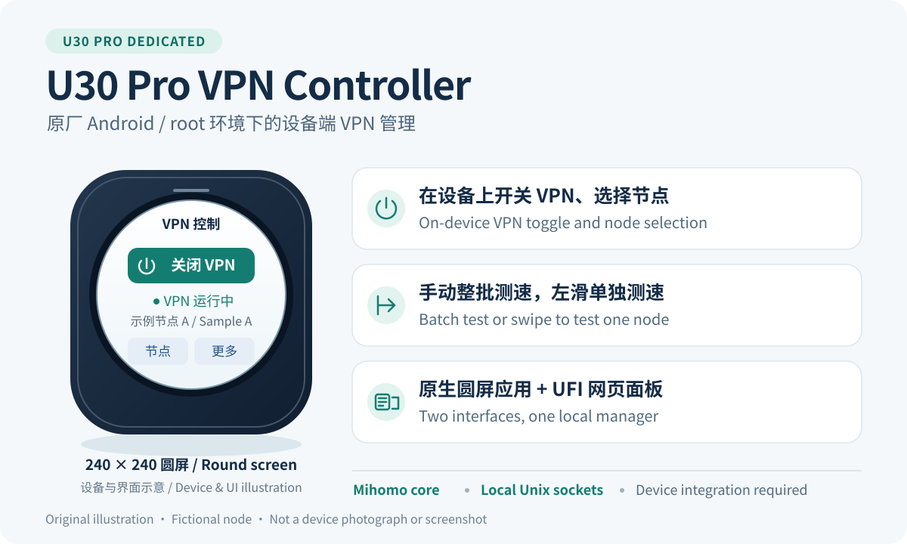
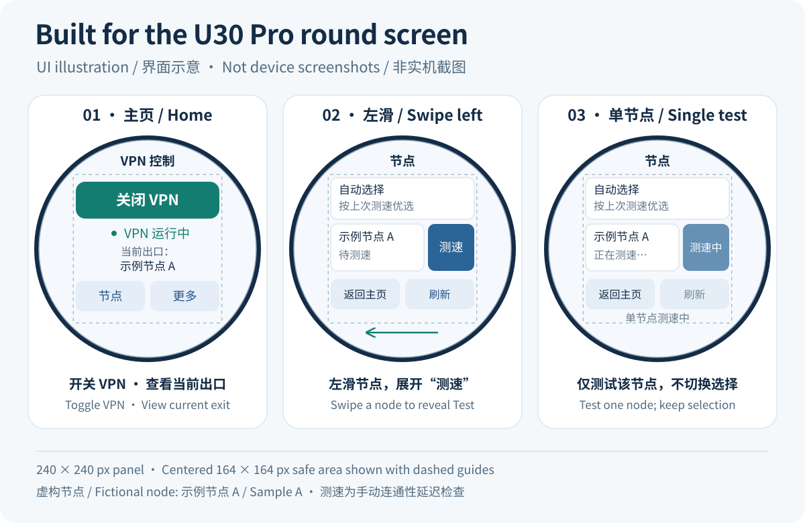
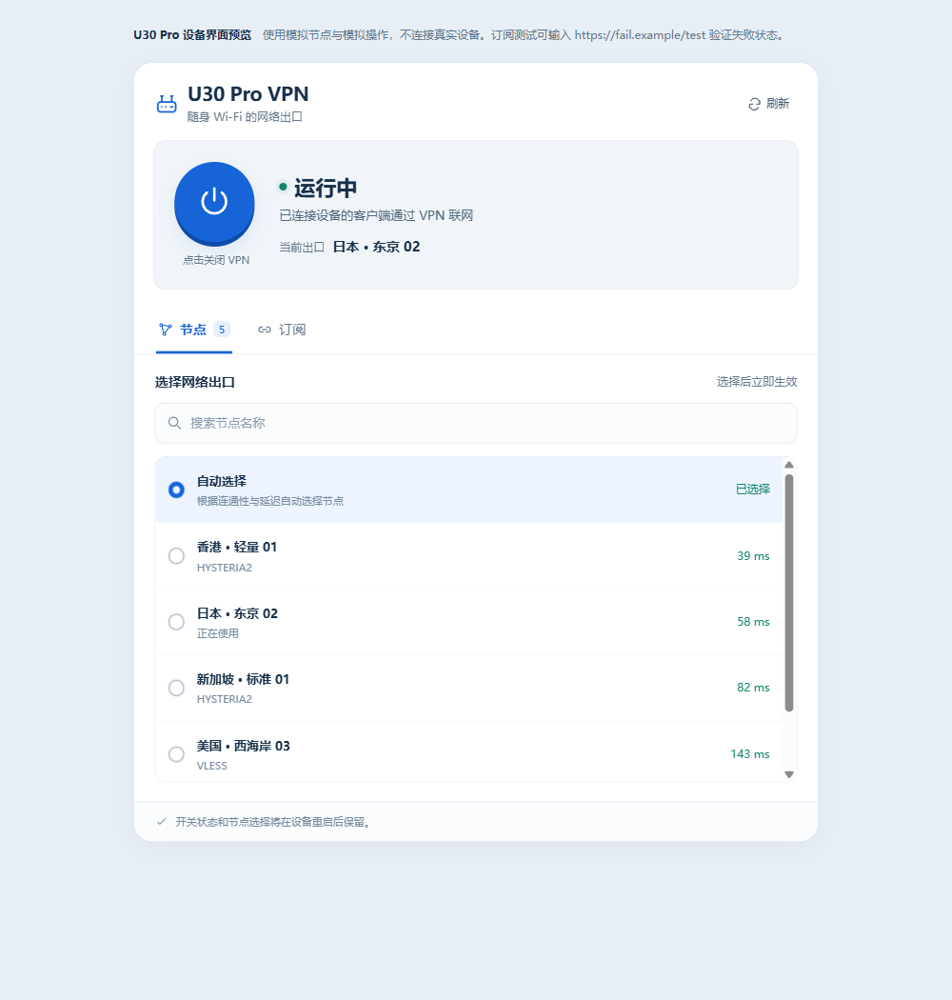

# U30 Pro VPN Controller

[中文](README.md) · [English](README.en.md) · [下载安装](https://github.com/zj-yzj/u30pro-vpn-controller/releases/tag/v1.3.0)

给已经 root 的中兴 U30 Pro 加上 VPN 管理功能。可以直接在设备圆屏上开关 VPN、切换节点和测速，也可以用手机或电脑打开 UFI 网页面板管理订阅。连接 U30 Pro 的设备共用它的 VPN 出口。

这个项目从我自己使用 U30 Pro 的需求开始，目前在自用设备上测试使用正常。保留原厂 Android 系统，代理转发使用 [Mihomo](https://github.com/MetaCubeX/mihomo)。

## 能做什么

- **本机控制**：开关 VPN、查看运行状态和当前节点，不用每次拿出手机。
- **切换节点**：点选节点即可切换；按住普通节点左滑，会出现单独的“测速”按钮。
- **按需测速**：节点页底部“刷新”测试整个列表，单节点按钮只测试这一项；结果完成后自动显示，没有定时全节点测速。
- **订阅管理**：在网页中添加或更换订阅，在圆屏上更新已保存的订阅。
- **快捷入口**：可开启一个可拖动的 VPN 悬浮按钮，退出控制页后也能从原厂首页打开。
- **保存设置**：记住 VPN 开关状态和节点选择，供后续启动使用。

这里的“测速”指连通延迟，单位为毫秒。刚导入节点时没有延迟记录，手动测一次即可。

## 安装

当前版本：**[v1.3.0](https://github.com/zj-yzj/u30pro-vpn-controller/releases/tag/v1.3.0)**。两种入口选一种，安装的模块相同。

| 文件 | 怎么用 |
| --- | --- |
| [Magisk 模块 ZIP](https://github.com/zj-yzj/u30pro-vpn-controller/releases/download/v1.3.0/U30ProVPN-1.3.0-Magisk.zip) | 在 U30 Pro 的 Magisk 中从本地安装 |
| [Android 安装器 APK](https://github.com/zj-yzj/u30pro-vpn-controller/releases/download/v1.3.0/U30ProVPN-1.3.0-Installer.apk) | 安装到 U30 Pro 本机，打开后授权 root 并安装模块 |
| [UFI 网页插件](https://github.com/zj-yzj/u30pro-vpn-controller/releases/download/v1.3.0/U30ProVPN.txt) | 导入已有 UFI-TOOLS，用来录入自己的订阅 |

1. 按下表确认设备条件，下载一个安装包和网页插件。
2. 安装模块，完成后重启 U30 Pro。
3. 在已有 UFI 页面导入插件，保存自己的订阅。首次安装默认关闭 VPN。
4. 节点出现后开启 VPN，就可以在圆屏或网页上操作了。

安装准备会联网下载约 **21.9 MB** 的官方 Mihomo 核心，安装包不附带订阅。这个版本用于全新安装，已有部署请先看[安装与恢复](docs/install.md)。

### 支持的设备

| 项目 | 要求 |
| --- | --- |
| 型号 | U30 Pro，设备型号 `MU5358` |
| 固件 | `U30ProV1.0.0B23` |
| 系统 | 原厂 Android API 35，`arm64-v8a`，SELinux 原本为 `Permissive` |
| root | 已安装 Magisk 28.1 或更新版本，版本码至少 `28100` |
| 网页管理 | 已有可使用 root 功能的 UFI-TOOLS |

安装器会检查设备及网络环境。这不是 root 或刷机工具，其他固件暂未适配。完整步骤、安装失败处理和卸载方法见[中文安装说明](docs/install.md) / [English guide](docs/install.en.md)。

## 界面

### 圆屏控制

圆屏界面示意。应用目前使用中文，主要操作放在 240 × 240 圆屏的中央区域。

### 网页管理

网页面板的离线预览，使用示例节点。

## 使用时的几个小提示

- 退出控制页不会关闭 VPN；要停止代理，请点“关闭 VPN”。
- 新增或更换订阅链接在网页上完成，圆屏负责更新已经保存的链接。
- 开启悬浮入口时，按系统提示授予“显示在其他应用上层”权限。
- 网页右上角“刷新”读取状态，圆屏节点页底部“刷新”才会开始整批测速。
- 重启后等待 VPN 进入运行状态，再进行需要通过代理的联网操作。

更多操作见[使用说明](docs/usage.md)，常见问题见 [FAQ](docs/faq.md)。

## 开发

项目由原生 Android 应用、Go 管理后端、UFI 网页插件和 Magisk 网关脚本组成。圆屏与网页共用同一套节点和订阅状态；订阅在设备端处理，Mihomo controller 使用本地 Unix socket。

- [构建与验证](docs/building.md)：构建网页、Android 应用和双入口安装包。
- [架构](docs/architecture.md)：管理请求和客户端流量如何经过各个组件。
- [设备集成](docs/device-integration.md)：固定网络布局、信任记录和移植要求。
- [测试记录](docs/testing.md)：实测情况与自动化检查。
- [参与贡献](CONTRIBUTING.md)：报告问题或提交修改。

遇到问题可以[提交 issue](https://github.com/zj-yzj/u30pro-vpn-controller/issues)，附上型号、固件、版本和复现步骤。分享日志或截图前，请去掉订阅链接和节点凭据。

## 许可

原创代码和文档使用 [MIT License](LICENSE)。Mihomo、Magisk、UFI-TOOLS 等组件遵循各自许可证，依赖与许可文本见[第三方说明](THIRD_PARTY_NOTICES.md)。
