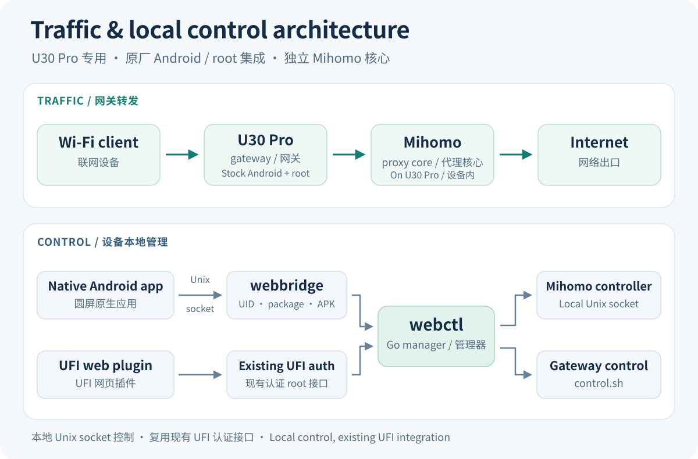

# Architecture

[简体中文](architecture.md) · [Project home](../README.en.md)



The web panel and circular-screen app share the Go management layer on the
device. A separately installed Mihomo process performs proxy forwarding.

```text
UFI web panel -> existing UFI authenticated root API --+
                                                    +-> webctl -> Unix HTTP socket -> Mihomo
Android app -> local Unix socket -> webbridge --------+          -> control.sh
```

## Management boundary

`webctl` owns desired power state, node selection, subscription normalization,
persistence and operation transactions. Subscription content is processed on
the device; it is not submitted to a public conversion service.
Browser and native requests use RSA-OAEP-SHA256 and AES-256-GCM envelopes.
The root-side key is generated at runtime, rather than shipped in source.

`webbridge` accepts a limited protocol and identifies clients through kernel
peer credentials, Package Manager information and the installed APK digest.
The circular control app has no Internet permission and does not receive direct root
access. Package and socket names form a shared protocol: changing one requires
updating both ends and the installation trust record.

## Installation path

The Magisk ZIP and separate `com.codex.u30vpn.installer` APK use identical module
bytes. The installer APK requests user root consent and invokes
`magisk --install-module`. It also has no Internet permission; the root helper
performs official online core acquisition. `u30setup` checks the fixed device,
file manifest and network baseline, stages module files during preparation, then
reconciles runtime, APK, trust and commit after reboot.

First state has no subscription/nodes and VPN off, with a device-generated key.
Trust accepts actual UID/path only when the installed APK matches the fixed
release digest. Unknown runtimes or same-package applications are refused.
See [Installation and recovery](install.en.md) for the full flow, cold-boot behavior,
deferred teardown and retained private backups, and [Testing](testing.en.md) for test coverage.

The Mihomo controller uses a device-local Unix socket. This project does not
add a LAN TCP administration listener. The web panel relies on UFI's existing
root authentication; request encryption does not replace the security of that
environment or of the rooted firmware.

## Manual latency measurements

Node measurement jobs are queued by explicit batch-refresh or single-node test
actions. A single-node test does not change the selected exit. Status reads
retrieve existing results and do not initiate measurements.

The foreground interface and optional floating entry read local status and
visibility. Subscription updates perform one-time
configuration and selected-exit validation. The reference configuration has
neither periodic provider health checks nor a URLTest group.

## Gateway reference

Gateway scripts depend on the stock device network layout, including the LAN
bridge, policy routing, DNS and SFP acceleration state. The reference source
includes protection and restoration logic. Read
[gateway integration notes](../gateway/README.en.md) before adapting it.
